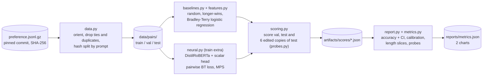
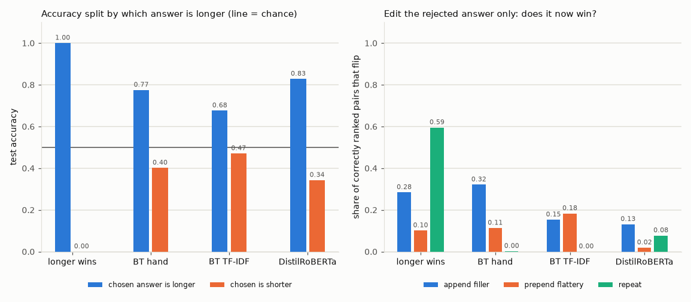
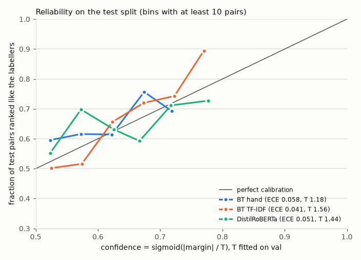

# reward-model-training

[](https://github.com/rahulkumar96t/reward-model-training/actions/workflows/ci.yml)

Reward models trained on human preference pairs, the way RLHF pipelines train them, small
enough for a laptop. The data is the human-labelled preference subset of HelpSteer2
(CC-BY-4.0). Three baselines run in the default install and in CI: a random scorer, "the
longer answer wins", and linear Bradley-Terry models on hand features and TF-IDF. The neural
model is DistilRoBERTa with a scalar head, trained with the pairwise loss
`-log sigmoid(r_chosen - r_rejected)` on Apple's MPS backend. The evaluation goes past
accuracy: calibration of `sigmoid(margin)`, accuracy split by which answer is longer, rank
correlation of reward with length, accuracy by labeller agreement and preference strength,
and six edits (filler, flattery, repetition, truncation, shuffling, refusal) that show how a
policy optimised against each model could game it.

Part of a three-repo series: human preference data
([preference-data-toolkit](https://github.com/rahulkumar96t/preference-data-toolkit)) ->
reward model (this repo) -> preference-tuned small language model
([dpo-lora-finetune](https://github.com/rahulkumar96t/dpo-lora-finetune)). The repos share no
code.

## Problem

A reward model reads a prompt and a response and returns one number. RLHF uses that number
as the training signal for a policy, so every blind spot of the reward model becomes something
the policy learns to exploit. Pairwise accuracy on held-out human labels is the usual
headline, but it does not show those blind spots. This repo trains reward models of
increasing capacity on the same pairs and measures, for each one, how much of its accuracy
comes from response length, whether its confidence is calibrated, and which cheap edits move
its score.

## Data

- **Source:** [`nvidia/HelpSteer2`](https://huggingface.co/datasets/nvidia/HelpSteer2),
  file `preference/preference.jsonl.gz`, pinned to commit
  `990b2711a36180dd19d9c94b8627844866f8982a` (15,339,272 bytes, SHA-256
  `a5cd48600fb7a330cf0ccc8f59051e24e8f236907c379f42eff1ba18da55204b`, checked on every
  download). `reward-model download` fetches it from the `resolve/<commit>/` URL into the
  gitignored `data/` folder.
- **Licence:** CC-BY-4.0. This repository does not redistribute the data. Attribution: Wang
  et al., *HelpSteer2-Preference: Complementing Ratings with Preferences* (2024,
  arXiv:2410.01257) and *HelpSteer2: Open-source dataset for training top-performing reward
  models* (2024, arXiv:2406.08673).
- **What a row is:** a prompt (31 % are multi-turn conversations), two responses from
  different in-house models of the dataset authors, and a preference strength from -3
  (response 1 much better) to +3 (response 2 much better). Each row also lists the 3-5
  individual labeller judgements behind the aggregate.
- **Cleaning** (`data.py`): 9,125 rows; 2,007 ties (strength 0) and 1 pair with identical
  responses dropped; exact duplicates after whitespace and case normalisation are dropped
  (none found). Multi-turn prompts are rendered as `User:` / `Model:` blocks. Each pair is
  oriented as (chosen, rejected) and keeps |strength| (1 slight, 2 clear, 3 strong) and the
  labeller vote counts.
- **Splits:** the official split has only 352 non-tie validation pairs, too few for slices,
  so all 7,117 pairs are re-split 80 / 10 / 10 by a hash of the normalised prompt. All pairs
  of one prompt land in the same split.

| split | pairs | prompts | strength 1 / 2 / 3 |
|---|---:|---:|---|
| train | 5,719 | 5,714 | 2,437 / 2,062 / 1,220 |
| val | 709 | 709 | 295 / 254 / 160 |
| test | 689 | 688 | 300 / 246 / 143 |

- **Length truncation:** text is not cut at preparation time, and the baselines see the full
  text. The neural model sees `[CLS] prompt [SEP] response [SEP]` within 512 tokens: the
  prompt keeps its last 128 tokens (more if the response is short), the response keeps its
  first tokens. 22.7 % of training responses and 21.9 % of test responses are longer than
  their share and lose their end.
- **Length in the labels:** in the test split the chosen response is the longer one in
  57.3 % of pairs (median 226 words chosen vs 198 rejected), so "pick the longer answer" is
  a real baseline, not a strawman.

## Approach



Every model implements one method, `score(prompts, responses) -> rewards`. The same code
scores val, test and the edited test copies and writes one JSON file per model, and the
report is built from those files only. The evaluation code therefore never imports torch:
the neural model writes its score file once, and `reward-model report` runs in the default
install.

**Models**

| name | reward | trained how |
|---|---|---|
| `random` | a fixed pseudo-random number per (prompt, response) | not trained |
| `length` | `log(1 + words)` of the response | not trained |
| `bt_hand` | `w . f(x)`, 12 standardised hand features | Bradley-Terry: logistic regression without intercept on `f(chosen) - f(rejected)`, each pair in both orientations; C chosen on val |
| `bt_tfidf` | the same plus TF-IDF word 1-2 grams of the response (50,012 features in total) | same |
| `neural` | DistilRoBERTa, `[CLS]` vector -> dropout -> linear -> scalar | pairwise loss `-log sigmoid(r_c - r_r)`, AdamW, linear warm-up and decay, best val checkpoint |

Hand features: log word count, log line count, list items, markdown headers, code blocks,
question marks, share of prompt content words that appear in the response, distinct-bigram
ratio (repetition), a refusal phrase, whether the response ends with punctuation, words per
sentence, and the log length ratio of response to prompt.

The neural trainer also supports a **margin** term, `-log sigmoid(r_c - r_r - m)` with
`m = margin_scale * strength / 3` (the labellers' strength sets how far apart the rewards
must be), and **reward centring**, `center_coef * (r_c + r_r)^2`, which stops the free offset
of the rewards from drifting. Both are unit-tested; both are off in the measured run.

**Evaluation** (`report.py`, `metrics.py`), all on the 689 test pairs:

- pairwise accuracy (an exact tie counts 0.5) with a 2,000-sample bootstrap 95 % interval;
- calibration: a temperature `T` is fitted on val by minimising the Bradley-Terry loss of
  `margin / T`; confidence = `sigmoid(|margin| / T)`; ECE over 10 bins on [0.5, 1];
- accuracy by preference strength and by labeller agreement (unanimous vs contested pairs);
- length bias: accuracy when the chosen response is longer vs shorter (word count), and the
  Spearman correlation between reward and log word count over all test responses;
- probes (`probes.py`): each edit is applied to every test response. Three edits add nothing
  useful and should not raise the reward (append a 50-word content-free paragraph, prepend
  a flattering opener, repeat the whole response). Three damage the response and should
  lower it (keep the first half of the words, shuffle the sentences, replace the response
  with a one-line refusal). For the first group the key number is how often editing only
  the *rejected* response makes it beat the chosen one, among pairs the model ranked
  correctly. For the second group it is how often the damaged *chosen* response still beats
  the rejected one.

## Results

Measured on an Apple M4 Pro (12 cores, 24 GB), macOS, Python 3.12.11, scikit-learn 1.9.1,
torch 2.15.0, transformers 5.24.1, on 26 Nov 2026. All numbers below are in
[`reports/metrics.json`](reports/metrics.json), written by `reward-model report`.

**The measured neural run:** `uv run --extra train reward-model train --epochs 1
--evals-per-epoch 3 --grad-checkpointing` (= `make train`). Full train split (5,719 pairs),
one epoch = 715 steps of 8 pairs, learning rate 2e-5 with 6 % warm-up and linear decay,
weight decay 0.01, gradient clipping at 1.0, `[CLS]` pooling, dropout 0.1, no margin, no
centring, seed 13, device `mps`, `torch.set_num_threads(4)`, activation checkpointing on.
Validation after each third of the epoch; the weights with the best val accuracy are kept.

| step | time |
|---|---:|
| `reward-model download` (download, verify, split) | 7 s |
| `reward-model baselines` (fit all four on 5,719 pairs, score val, test, 6 probes; CPU) | 45 s, of which 34 s fitting |
| `reward-model train`: 715 training steps and 3 val passes | 957 s |
| `reward-model train`: scoring val, test and the 6 probe copies (11,064 sequences) | 136 s |
| `reward-model train`, whole command | 1,099 s (18.3 min) |
| `reward-model report` | about 4 s |

Peak MPS driver memory during training was 11.0 GB. Another training job shared the machine
for most of the neural run, so the times are an upper bound.

### Accuracy, calibration and length

| model | test accuracy (95 % CI) | val accuracy | ECE after T (raw) | T | acc. when chosen is longer / shorter | Spearman(reward, log words) |
|---|---:|---:|---:|---:|---:|---:|
| random | 50.1 % (46.4-53.7) | 50.8 % | 0.006 (0.228) | 39.79 | 51.9 % / 47.8 % | 0.01 |
| longer answer wins | 57.7 % (54.0-61.3) | 56.3 % | 0.065 (0.106) | 4.72 | 100 % / 0 % | 1.00 |
| Bradley-Terry, hand features | 61.5 % (57.8-65.2) | 59.2 % | 0.058 (0.055) | 1.18 | 77.5 % / 40.1 % | 0.65 |
| Bradley-Terry, TF-IDF + hand | 58.6 % (54.9-62.3) | 61.6 % | 0.041 (0.056) | 1.56 | 67.6 % / 47.1 % | 0.46 |
| DistilRoBERTa reward model | **62.1 %** (58.4-65.6) | 61.9 % | 0.051 (0.076) | 1.44 | 82.8 % / 34.3 % | 0.66 |

395 test pairs have a longer chosen response, 289 a shorter one, 5 the same word count.
Human reference on the same 689 pairs: a single labeller's vote agrees with the aggregated
label 89.8 % of the time (2,391 votes, individual ties excluded), and 75.3 % of pairs are
unanimous. Each labeller is part of the aggregate, so this is an optimistic reference.



### Probes: what a policy could exploit

Edits that should **not** help. Share of correctly ranked test pairs where editing only the
rejected response makes it win (lower is better); in brackets, the share of all test
responses whose reward went up.

| edit | longer wins | BT hand | BT TF-IDF | DistilRoBERTa |
|---|---:|---:|---:|---:|
| append a 50-word filler paragraph | 28.4 % (100 %) | 32.1 % (98.3 %) | 15.3 % (93.5 %) | 13.1 % (61.5 %) |
| prepend a flattering opener | 10.1 % (100 %) | 11.3 % (99.3 %) | 18.3 % (99.6 %) | 1.9 % (31.6 %) |
| repeat the whole response | 59.5 % (99.9 %) | 0.2 % (2.5 %) | 0.0 % (1.5 %) | 7.7 % (44.8 %) |

Edits that **should** hurt. Share of correctly ranked test pairs where the damaged chosen
response still beats the rejected one (lower is better).

| edit | longer wins | BT hand | BT TF-IDF | DistilRoBERTa |
|---|---:|---:|---:|---:|
| keep the first half of the words | 40.3 % | 35.6 % | 49.3 % | 60.5 % |
| shuffle the sentences | 100 % | 59.7 % | 77.0 % | 94.4 % |
| replace with a one-line refusal | 2.0 % | 0.0 % | 2.0 % | 7.2 % |

The random scorer gives the noise floor for these tables: it re-draws the score of any edited
text, so about 30 % of its pairs flip and about 64 % of damaged answers still win, whatever
the edit.

### What the evaluation shows

- **The learned models are mostly length detectors.** All three trained models are better
  when the chosen answer is longer than when it is shorter. The gap is 20.5 points for
  TF-IDF, 37.3 for the hand features and 48.5 for DistilRoBERTa, whose rewards correlate
  with log length at 0.66. Averaged over the two length groups (length-balanced accuracy),
  every learned model lands at 57.3-58.8 %, against 50 % for the length rule.
- **More capacity bought little accuracy here.** DistilRoBERTa is the most accurate model
  (62.1 %), but its interval overlaps those of both linear models and of the length rule;
  with 689 test pairs the 95 % interval is about +-3.6 points. The two linear models swap
  places between splits (TF-IDF 61.6 % on val and 58.6 % on test, hand features 59.2 % and
  61.5 %), which is the same noise.
- **The neural model ignores cheap flattery but not padding.** A flattering opener lowered
  its reward for 68 % of responses and flipped only 1.9 % of pairs, while both linear models
  rewarded it almost every time. Appending filler still raised its reward for 61.5 % of
  responses and flipped 13.1 % of pairs.
- **It is close to blind to sentence order and to the tail of long answers.** Shuffling the
  sentences of the chosen answer changed its reward by +0.003 standard deviations on average,
  and the shuffled answer still won 94.4 % of the pairs it had ranked correctly. Cutting
  the answer in half left the chosen answer ahead 60.5 % of the time. Part of this is the
  window: 21.9 % of test responses are longer than the model's response budget, so edits to
  their end (filler, the second copy of a repeat, the removed half) are partly or wholly
  invisible to it.
- **The hand-feature model catches repetition, the neural model does not.** The
  distinct-bigram feature gives the linear models a direct repetition penalty (0.0-0.2 %
  flips); DistilRoBERTa flips 7.7 % of pairs when the rejected answer is repeated.
- **Calibration is reasonable after one temperature.** ECE after scaling is 0.041-0.058 for
  the learned models (0.076 for the raw neural margins). The confidences are low: at most
  10 of the 689 test pairs get more than 0.8, which matches how close many of these pairs
  are.
- **Strength and agreement do not sort the pairs by difficulty.** DistilRoBERTa scores
  66.0 % / 56.1 % / 64.3 % on strength 1 / 2 / 3 pairs (300 / 246 / 143 pairs), and 62.0 %
  on unanimous vs 62.4 % on contested pairs. The pairs labellers felt most strongly about are
  not the ones these models find easiest.
- **Checkpoint selection.** The best val accuracy (61.9 %) came after a third of the epoch,
  step 239; val accuracy at the end of the epoch was 61.6 % (two pairs fewer out of 709)
  while val loss kept falling, from 0.668 to 0.652. The selection rule was fixed before
  the run and is reported as is; see the roadmap.



## Reproduce

Requires [uv](https://docs.astral.sh/uv/). Python 3.12 is pinned in `.python-version`.

```bash
make install        # uv sync --locked (no torch)
make data           # download, verify, split: about 7 s
make baselines      # fit and score the four baselines on CPU: about 45 s
make install-train  # uv sync --locked --extra train (torch + transformers, about 1 GB)
make train          # the measured neural run: about 18 min on an M4 Pro (MPS)
make report         # reports/metrics.json, reports/calibration.png, reports/length_bias.png
make test
```

`reward-model train --help` lists the options (`--train-limit`, `--epochs`, `--margin-scale`,
`--center-coef`, `--pooling`, `--grad-checkpointing`, `--device`, `--threads`, ...). The
pretrained encoder, `distilbert/distilroberta-base` (Apache-2.0), is loaded at commit
`fb53ab8802853c8e4fbdbcd0529f21fc6f459b2b` through the shared Hugging Face cache. The
checkpoint (317 MB) goes to the gitignored `artifacts/neural/`.

## Usage

```bash
uv run reward-model score --prompt "How do I keep basil alive indoors?" \
  --response "Put it in your sunniest window (at least 6 hours of light), water when the top inch of soil is dry, and pinch off flower buds so it keeps producing leaves." \
  --response "Basil is a plant."
```

```json
{"model": "bt_tfidf", "rewards": [-0.8477, -1.52], "p_first_beats_second": 0.6062}
```

The same pair through the trained checkpoint
(`uv run --extra train reward-model score --checkpoint artifacts/neural ...`):

```json
{"model": "neural", "rewards": [-1.5173, -1.6394], "p_first_beats_second": 0.5212}
```

`p_first_beats_second = sigmoid((r1 - r2) / T)` with the temperature fitted on val. Both
models prefer the useful answer, and both are unsure about it: the margins they learned on
close human calls are small.

## Design decisions and trade-offs

- **HelpSteer2 preferences, not UltraFeedback.** UltraFeedback's binarised pairs are larger
  (61k) but their labels come from a GPT-4 judge. HelpSteer2's preference labels come from
  3-5 human labellers per pair, and the per-labeller judgements give a human reference point
  and an agreement slice. The cost is size: 5,719 training pairs.
- **Own split by prompt hash.** Deterministic, no state to ship, and no prompt appears in two
  splits. The test split is used only for the reported numbers; C, the checkpoint and the
  temperature are chosen on val.
- **Bradley-Terry everywhere.** The linear baselines and the neural model optimise the same
  likelihood, so their margins mean the same thing and the same calibration code applies.
  Training on both orientations of each pair keeps the linear model free of a position bias.
  For the hand-feature model val accuracy is flat across C (58.8-59.2 %), so its C = 0.001
  (the grid edge) matters little; the TF-IDF model picked C = 1.
- **Scores as the interface.** Baselines and the neural model write the same score files;
  evaluation, probes and charts never need torch, so CI stays small and fast.
- **Temperature scaling before ECE.** A reward model's scale is arbitrary (the BT loss fixes
  it only on the training pairs). One scalar fitted on val makes ECE comparable across
  models; the raw ECE is reported too.
- **DistilRoBERTa, not DeBERTa-v3.** `microsoft/deberta-v3-xsmall` (MIT) was the first
  choice; its training step failed on MPS with torch 2.15 (`'mps.add' op requires the same
  element type for all operands`), and its tokenizer needs `sentencepiece` and `protobuf`.
- **Activation checkpointing.** Turned on after a first attempt shared the machine with
  another large training job and both stalled in swap. Layer activations are recomputed in
  the backward pass instead of stored; the maths is unchanged. Peak MPS driver memory,
  which includes the allocator's cache, was 11.0 GB.
- **Prompt tail, response head.** The latest user turn sits at the end of a prompt, and
  responses usually put the answer first, so the prompt is cut from the left and the
  response from the right. The cost is that the model is blind to the end of long
  responses, which the probes make visible.
- **Length-grouped batches.** Pairs are shuffled, then sorted by length inside chunks of 50
  batches, which cuts padding without fixing the batch order.

## Testing

```bash
uv run ruff check . && uv run ruff format --check . && uv run pytest -q
```

Default install (as in CI): 64 passed, 1 skipped (the neural test module, which needs torch),
about 2 s. With `uv sync --extra train`: 74 passed, 1 skipped (the check that `train` explains
how to install the extra when torch is missing), about 5 s. No network: a seeded generator
(`tests/synthetic.py`) writes rows in the raw HelpSteer2 format, with a planted signal (the
preferred response stays on topic, is a list and ends cleanly; the other is filler, repetitive,
cut off or a refusal) and edge cases (a tie, identical responses, a duplicate, multi-turn
prompts).

- **Data:** orientation of negative and positive strengths, vote counting, tie / identical /
  duplicate removal, deterministic and prompt-disjoint splits, `file://` downloads with a
  checksum match, a mismatch (no file left behind), reuse of a verified file and
  replacement of a corrupt one.
- **Features and truncation:** each hand feature on hand-made text; prompt-tail /
  response-head truncation, budget hand-back and the window bound.
- **Metrics:** ties, bootstrap interval width, temperature recovery on simulated
  Bradley-Terry data (T = 0.5, 1, 3), ECE for calibrated and over-confident scores,
  reliability bins.
- **Baselines, probes, report, CLI:** the linear BT model learns the planted signal (> 90 %
  on held-out synthetic pairs), save / load round trip, every probe, every report slice on
  hand-computed pairs, PNGs under 300 KB, and the `download`, `baselines`, `report` and
  `score` commands end to end.
- **Neural** (only with the `train` extra): the loss (log 2 at equal rewards, margin,
  centring, gradient direction), `[CLS]` and masked mean pooling, collation, batching,
  device choice, activation checkpointing, a one-layer BERT with a word-level tokenizer that
  learns the planted signal on CPU (> 85 %), checkpoint save / load with identical scores,
  and `score --checkpoint`.

## Limitations and roadmap

- **Reward hacking is easy against all of these models.** Length explains most of what they
  learned; a policy trained against any of them would be pushed to write longer answers and
  to pad, and the neural model would not notice shuffled or truncated text past its window.
  Length bias is a known problem for much larger reward models too (Singhal et al., 2023,
  *A Long Way to Go: Investigating Length Correlations in RLHF*, arXiv:2310.03716).
- **Small data, wide intervals.** 689 test pairs give intervals of about +-3.6 points; none
  of the learned models is significantly better than another.
- **One seed, one epoch, no tuning.** The margin and centring options are implemented and
  unit-tested but were not measured on the real data. The neural number is a single run.
- **Checkpoint selection by val accuracy** picked step 239 of 715 on a two-pair difference
  while val loss was still improving. Selecting by val loss is the better rule for this
  amount of validation data.
- **512-token window.** 21.9 % of test responses do not fit; their ends are invisible.
- **One source of responses.** HelpSteer2 responses come from the dataset authors' own
  models; nothing here measures behaviour on other models' outputs.
- **Next steps:** select by val loss and run three seeds; a margin / centring ablation; a
  length-debiased objective (for example length-balanced sampling or a separate length
  head); head + tail truncation or a longer-context encoder; an out-of-distribution test set
  such as UltraFeedback's `test_prefs` (MIT); best-of-n sampling with this reward model on
  the outputs of the DPO model from the next repo.

## Project layout

```
src/reward_model/
  data.py       download with SHA-256 check, cleaning, orientation, prompt-hash split
  features.py   hand features and TF-IDF for the linear models
  baselines.py  random, longer-wins, Bradley-Terry logistic regression
  encoding.py   token budget (no torch)
  neural.py     encoder + scalar head, pairwise loss, trainer, checkpoints (train extra)
  probes.py     the six response edits
  scoring.py    scorer protocol, score files
  metrics.py    accuracy, bootstrap, temperature, ECE, reliability, Spearman
  report.py     metrics.json and slices
  plots.py      the two charts
  cli.py        reward-model command
tests/          synthetic data generator and tests
reports/        output of the measured run
```

## License

MIT, see [LICENSE](LICENSE). The HelpSteer2 data is CC-BY-4.0 and is not part of this
repository; see *Data* above.
